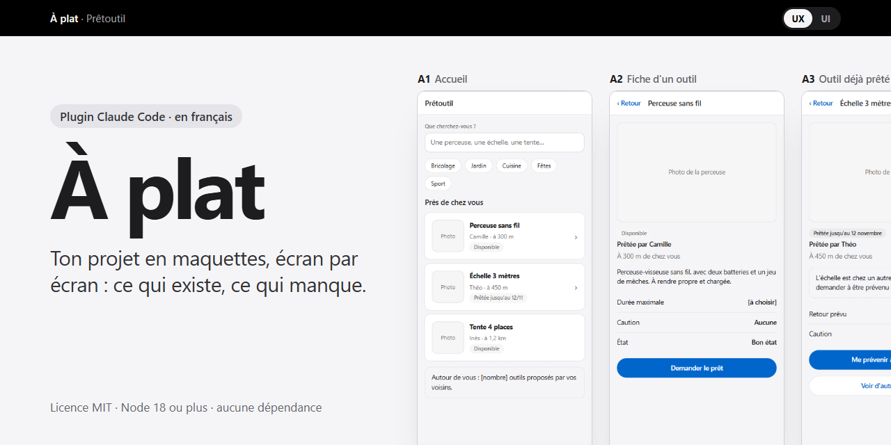
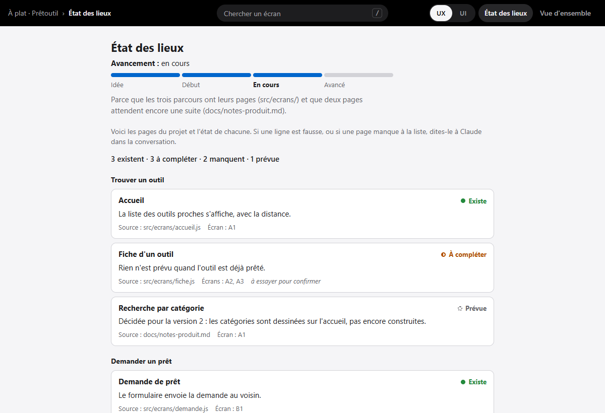
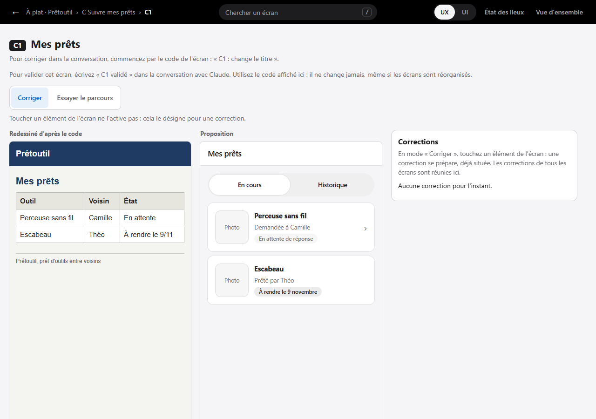

<div align="center">



Claude lit ton projet et le met à plat en maquettes : la liste des pages et leur état, ce qui manque, et chaque écran dessiné, avec l'actuel et la proposition côte à côte quand une page change.

Licence MIT · Node 18 ou plus · aucune dépendance · construit avec Claude Code

[Installation](#installation) · [Démarrage rapide](#démarrage-rapide) · [Ce que ça coûte en jetons](#ce-que-ça-coûte-en-jetons) · [Documentation](#documentation)

</div>

## Pourquoi À plat ?

Tu construis une appli avec Claude, que tu sois développeur ou non. À un moment, tu ne sais plus très bien où tu en es : quelles pages existent, lesquelles sont à moitié faites, ce qui a été oublié en route. À plat te le montre, à n'importe quel moment : quand tu n'as qu'une idée, en plein travail, ou quand l'appli est déjà en ligne.

- **L'état des lieux :** chaque page, avec son état (Existe, À compléter, Manque, Prévue), une raison courte et le fichier d'où vient le constat. Une barre dit où en est le projet.
- **Ce qui manque :** les états oubliés d'un écran (vide, erreur, refus), les boutons qui ne mènent nulle part, les parcours qui s'arrêtent en route.
- **Les écrans, page par page,** sur une seule page à ouvrir d'un double-clic. Une page qui change montre l'actuel et la proposition côte à côte. Une page qui ne change pas est dessinée une fois, marquée « Inchangé ».

**Le principe : l'outil met à plat ce que tu as, et n'impose rien.** Il n'ajoute aucune fonction de lui-même. Ce qui semble manquer devient un point à trancher, et une page qui manque ne se dessine que si tu le demandes. Ce qu'il ne sait pas reste entre [crochets]. Chaque constat dit d'où il vient, et ce qui a été lu sans être vu marcher est marqué « à essayer pour confirmer ».





C'est une première version : sur un projet qu'il n'avait jamais vu, Claude a trouvé 13 manques sur 19, sans en inventer. Le détail, et ce qui n'a pas encore été essayé : [Ce que l'outil ne sait pas encore bien faire](docs/utiliser-a-plat.md#ce-que-loutil-ne-sait-pas-encore-bien-faire).

## Installation

Il te faut Claude Code et Node.js 18 ou plus. À plat marche avec l'abonnement que tu as déjà, sans clé d'API.

Le plugin ne passe par aucune boutique : tu l'installes depuis ce dépôt GitHub. Le plugin et la source s'appellent tous deux `a-plat`. Dans un terminal :

```bash
claude plugin marketplace add Doukay/a-plat
claude plugin install a-plat@a-plat
```

Ouvre ensuite une nouvelle session : les plugins se chargent au démarrage. Mettre à jour, revenir à une version, vérifier ton installation et retirer le plugin : tout est dans [Pour commencer](docs/bien-demarrer.md).

## Démarrage rapide

1. Ouvre Claude Code dans ton projet. Si tu n'as qu'une idée, ouvre-le dans un dossier vide.
2. Tape :
   ```text
   /a-plat
   ```
   (Si un autre plugin a déjà une commande `/a-plat`, tape le nom complet : `/a-plat:a-plat`.)
3. Claude avance par étapes et s'arrête à chacune pour attendre ta réponse :
   - il lit ton projet sans rien modifier, ou te pose quelques questions courtes si tu n'as qu'une idée ;
   - il écrit l'état des lieux, et tu le corriges : rien n'est dessiné avant ;
   - il propose des réglages d'après ton projet (téléphone ou ordinateur, rangement, finition, rythme) ;
   - il dessine 1 ou 2 écrans et te demande si la direction te va, puis il fait le reste.
4. Ouvre `a-plat/index.html` d'un double-clic. Claude te le rappelle à chaque fois.

Pour corriger un écran, cite son code dans la conversation :

> B3 : change le titre

ou touche l'élément sur la page, en mode **Corriger**, et colle ce que copie le bouton **Copier pour Claude**. Pour valider : « B3 validé ». Claude ne valide jamais à ta place. À la fin, demande le passage au code : la liste des changements à faire, des questions ouvertes et des points à vérifier.

Claude te vouvoie, sauf si tu le tutoies. La page aussi te vouvoie.

## Ce que ça coûte en jetons

| Sans jeton | Sur ton compte Claude |
|---|---|
| Ouvrir la page, parcourir, chercher, zoomer | Lire ton projet et écrire l'état des lieux |
| Passer de l'UX à l'UI, essayer le parcours | Dessiner chaque écran, et le relire avant de te le montrer |
| Préparer et copier des corrections | Appliquer tes corrections |
| Le contrôle (`verifier.mjs`) et la copie de la page | Le passage au code |

Ce que montrent les essais, honnêtement :

- **Un petit projet** (une quinzaine de pages, comme Prêtoutil dans `docs/essais/`) : l'état des lieux et les deux premiers écrans tiennent en trois échanges. C'est léger.
- **Un gros projet coûte cher.** Sur une appli web réelle d'environ 130 pages (essai de l'auteur, compte rendu non publié car il décrit un vrai projet), le parcours complet a donné environ 240 écrans, en huit échanges et à peu près deux heures. Sur un abonnement, c'est une bonne part de ton quota.
- **La finition fidèle coûte encore plus :** chaque écran demande de lire tous les composants qu'il affiche. À l'essai (deux écrans de cette même appli, non publié), il a fallu une dizaine de minutes par écran.

Pour dépenser moins : commence par l'état des lieux seul, dessine un parcours à la fois, et garde la finition « couleurs du projet » plutôt que « fidèle » sur un gros projet. Une page inchangée n'est dessinée qu'une fois. Détail dans [Comment ça marche](docs/comment-ca-marche.md#ce-qui-consomme-des-jetons).

## Ce que ça ajoute à ton projet

Un dossier `a-plat/`, à la racine, et rien d'autre. **Seul `a-plat/sources/` est à garder dans Git :** le plan, les écrans, l'existant, le passage au code. Le reste (`index.html`, `.cache/`) se refait à chaque passage et s'ignore tout seul. Ton code, ton `.gitignore` et tes notes pour Claude (`CLAUDE.md`) ne sont jamais touchés. Voir [Ce qu'il y a dans ton projet](docs/fichiers-du-projet.md).

## Confidentialité

- **Claude lit ton projet pour le mettre à plat, et ce qu'il lit part chez Anthropic**, sur ton compte, comme pour n'importe quelle tâche que tu lui donnes.
- L'outil lui-même n'envoie rien : pas de mesure d'usage, pas de compte. La page ne charge rien d'Internet, sauf une police en ligne si tu la demandes pour ta charte.
- Claude n'ouvre pas tes fichiers de secrets (`.env`, clés) et ne met aucune donnée réelle dans les maquettes. Ce sont des règles qu'il suit, pas des verrous : relis ce qu'il écrit.
- Il ne lance ton projet qu'avec ton accord, et ne modifie jamais ton code.

Le détail, et ce qu'aucun test ne garantit : [Confidentialité et sécurité](docs/confidentialite-et-securite.md).

## Documentation

| | |
|---|---|
| [Pour commencer](docs/bien-demarrer.md) | Installer, mettre à jour, vérifier ton installation, revenir en arrière, retirer |
| [Utiliser À plat](docs/utiliser-a-plat.md) | Le parcours avec Claude, la page vue par vue, les finitions, ce que l'outil ne sait pas encore bien faire |
| [Ce qu'il y a dans ton projet](docs/fichiers-du-projet.md) | Le dossier `a-plat/`, ce qui se garde dans Git, la reprise d'un ancien dossier |
| [Comment ça marche](docs/comment-ca-marche.md) | Une page sans serveur, les écrans en cadres, le contrôle, la finition fidèle |
| [Confidentialité et sécurité](docs/confidentialite-et-securite.md) | Ce qui quitte ta machine, ce que l'outil lance, ce qu'il ne garantit pas |
| [Questions fréquentes](docs/questions-frequentes.md) | Ce qu'on se demande le plus souvent |
| [Dépannage](docs/depannage.md) | Les problèmes courants et leurs solutions |
| [Développer À plat](docs/developpement.md) | Le dépôt, les tests, les versions, les comptes rendus d'essai |

## Proposer une amélioration

Les corrections sont les bienvenues : [CONTRIBUER.md](CONTRIBUER.md) dit comment faire, et surtout ce qui ne doit jamais être envoyé (rien de ton projet, aucune capture de ton appli). Chaque proposition est relue avant d'être intégrée.

## Signaler un problème

Pour une faille de sécurité, lis [SECURITY.md](SECURITY.md) et signale-la en privé. Pour le reste, ouvre un ticket dans l'onglet **Issues** de ce dépôt, en décrivant le problème avec des mesures plutôt qu'avec ton code.

## Licence

[MIT](LICENSE) © 2026 Doukay. Voir le [journal des changements](CHANGELOG.md) pour ce que contient chaque version.

Construit avec Claude Code.
