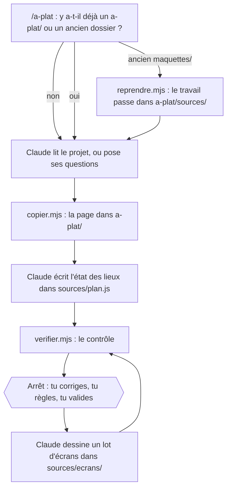

# Comment ça marche

À plat partage le travail entre Claude et quelques petits scripts. Claude fait ce que seul un lecteur peut faire : lire ton projet, trouver ce qui manque, dessiner les écrans, appliquer tes corrections. Les scripts font le travail mécanique : mettre la page en place et contrôler ce que Claude a écrit. Ce sont des scripts Node.js sans dépendance, et ils ne coûtent aucun jeton.

## Ce qui consomme des jetons

| Action | Qui la fait | Jetons |
|---|---|---|
| Ouvrir la page, chercher, zoomer, replier, passer de l'UX à l'UI, essayer le parcours | La page, dans ton navigateur | **Aucun** |
| Préparer des corrections sur la page et les copier | La page | **Aucun** |
| Copier la page, contrôler le dossier, reprendre un ancien dossier | Les scripts, sur ton ordinateur | **Aucun** (Claude les lance, ce qui compte un peu) |
| Lire ton projet et écrire l'état des lieux | Claude | Sur ton compte. Plus le projet est gros, plus ça coûte |
| Dessiner les écrans, les relire avant de les montrer | Claude | Sur ton compte, à chaque écran. C'est le plus gros poste |
| Appliquer une correction, écrire le passage au code | Claude | Sur ton compte |

**Ordres de grandeur, tirés des essais :**

- Un petit projet inventé, d'environ vingt pages : l'état des lieux, les réglages et deux écrans en trois échanges.
- Une appli web réelle d'environ 130 pages (essai de l'auteur, compte rendu non publié car il décrit un vrai projet) : environ 240 écrans en onze rangées, dont plus des deux tiers « Inchangé », en huit échanges et à peu près deux heures. Le lancement s'est arrêté plusieurs fois en route, quand il atteignait sa limite : Claude dit alors où il en est et ce qui reste.
- La finition fidèle : à l'essai (deux écrans de cette même appli, non publié), une dizaine de minutes par écran, chacun transcrit par une aide (un sous-agent). Sur une grosse appli, c'est bien plus lourd que la finition « couleurs du projet ».

Sur un abonnement, tout cela se compte en quota : un gros projet en prend une bonne part, la finition fidèle encore plus. **Pour dépenser moins :** fais d'abord l'état des lieux seul, dessine un parcours à la fois, choisis le rythme « par lots » plutôt que « tout d'un coup » pour garder la main, et réserve la finition fidèle aux écrans qui comptent. Une page inchangée n'est dessinée qu'une fois, sans l'actuel à côté : c'est voulu, deux fois le même contenu coûterait le double.

Sur un gros lot, Claude peut répartir le dessin entre plusieurs aides en parallèle. C'est plus rapide, pas moins cher.

## Une page sans serveur

La page est un fichier `index.html` qui s'ouvre d'un double-clic, avec son moteur dans `.cache/`. Il n'y a rien à installer ni à lancer. Les corrections passent par la conversation : un serveur n'apporterait que l'écriture directe des corrections, ce qui ne vaut pas une installation de plus.

`sources/plan.js` est un fichier de script, pas du JSON : une page ouverte d'un double-clic n'a pas le droit de lire un fichier JSON voisin. Claude l'écrit, la page le lit et ne le modifie jamais.

## Les écrans dans des cadres

Chaque écran est un fichier HTML ordinaire, affiché dans un cadre (`iframe`). Le cadre isole ses couleurs de celles de la page, et le fichier s'ouvre aussi seul.

Une page ouverte d'un double-clic ne peut pas regarder dans ses cadres. Chaque écran porte donc un petit script, `relais.js`, qui parle à la page par messages : quand l'écran est prêt (et sa hauteur), quel élément a été touché, vers quel écran mène un lien. La page lui répond le mode choisi (Corriger ou Essayer le parcours) et la finition (UX ou UI). Elle ne retient que les messages qui viennent de ses propres cadres. Sans `relais.js`, la page ne sait pas ce qui a été touché : le contrôle l'exige dans chaque écran.

Avant la construction, un essai sous Edge avec 124 écrans jetables a chargé la page en moins d'une seconde, et le défilement est resté fluide.

## UX et UI

Chaque écran est dessiné une seule fois, avec les classes de `.cache/commun.css`, sans aucune couleur à lui. Ses couleurs viennent de deux jeux de variables aux mêmes noms : l'UX en tête de `commun.css`, l'UI dans `sources/charte.css`. Le bouton **UX | UI** fait poser à `relais.js` un attribut sur chaque écran, qui passe d'un jeu à l'autre. Un écran ouvert seul s'affiche en UX.

## La copie et la reprise

- **`copier.mjs`** met la page en place dans `a-plat/`, ou la refait : `index.html`, `.gitignore` et `.cache/` à chaque passage. Il crée `sources/` et ce qui y manque, sans jamais toucher à un fichier qui y est. Il refuse un dossier qui n'est pas à l'outil, et un ancien dossier de maquettes.
- **`reprendre.mjs`** passe un ancien dossier `maquettes/` au dossier `a-plat/` d'aujourd'hui, sans toucher à l'ancien (voir [Un ancien dossier `maquettes/`](fichiers-du-projet.md#un-ancien-dossier-maquettes)).

## Le contrôle

`verifier.mjs` relit le dossier, sans rien afficher à l'écran, après chaque lot et avant que Claude te montre quoi que ce soit :

- chaque écran du plan a son fichier, et chaque fichier son écran ;
- les codes d'écran sont uniques, et chaque code cité (dans l'état des lieux, dans une note) existe ;
- les liens entre écrans mènent à un fichier qui existe ;
- le HTML est bien fermé, et chaque écran porte `relais.js` ;
- rien ne vient d'Internet, sauf la police en ligne que tu aurais demandée ;
- aucun écran n'écrit de couleur, et le bloc UI est là quand la finition l'utilise ;
- aucun lien d'un ancien dossier ne reste.

Il liste aussi les [crochets] restants, pour information. Sans Node, Claude fait ces contrôles lui-même et te dit ceux qu'il n'a pas pu faire.

## La finition fidèle

Avec la finition fidèle, chaque écran est écrit avec le balisage et les classes de ton projet, mot pour mot, et charge sa vraie feuille de style. Deux scripts s'en chargent, **seulement après ton accord**, demandé une fois pour les deux :

- **`style-du-projet.mjs`** construit le style de ton projet dans `a-plat/.cache/projet/` : avec le Tailwind 4 installé dans ton projet, ou en mettant bout à bout une feuille de style simple et ses `@import`. Il copie les polices que ton code importe, et les images et polices citées. Ce qui viendrait d'Internet est retiré, ce qui est hors du projet n'est pas copié. Avec Tailwind, il ne garde que les classes des écrans : Claude le relance après chaque lot. Il s'arrête sur Tailwind 3, ou si Tailwind n'est pas installé.
- **`icones.mjs`** donne le dessin exact des icônes Lucide, rendu par le `lucide-react` installé dans ton projet. Il n'écrit rien : Claude colle le résultat dans l'écran.

Ces deux scripts **exécutent des paquets installés de ton projet** (Tailwind et ses extensions, React, Lucide) : c'est du code de ton projet, d'où l'accord demandé. Ils ne lisent que dans ton projet et n'écrivent que dans `a-plat/.cache/projet/`, ou rien du tout pour les icônes.

En UX, le même écran passe en gris et dans la police du système. L'actuel garde toujours le vrai style. Si tu acceptes qu'on lance ton appli, Claude peut comparer un actuel fidèle à la vraie page, à la même largeur, et corriger les écarts. Sans cet accord, il écrit « pas comparé à l'appli lancée ».

## Les règles données à Claude

Ce sont des règles écrites pour Claude, dans la méthode du plugin, pas des verrous techniques. Claude les suit, mais les essais ont montré des écarts (voir [Ce que l'outil ne sait pas encore bien faire](utiliser-a-plat.md#ce-que-loutil-ne-sait-pas-encore-bien-faire)) : relis ce qu'il dit et ce qu'il écrit.

- Il ne modifie jamais ton code. Il n'écrit que dans `a-plat/`.
- Il ne lance pas ton projet (installation, construction, démarrage) sans ton accord, et il te dit avant que cela peut écrire dans le projet et lire sa configuration.
- Il n'ouvre pas tes fichiers de secrets. Il peut citer leur nom, jamais leur contenu.
- Il ne met aucune donnée réelle dans les maquettes, même les données d'exemple de ton projet : les exemples sont inventés.
- Il n'invente ni prix, ni durée, ni texte officiel : [crochets].
- Il ne dit pas qu'une page marche, ni comment elle s'affiche, s'il ne l'a pas vu. Ce qui est seulement lu est « à essayer pour confirmer ».
- Il n'ajoute aucune fonction de lui-même : ce qui semble manquer devient une question.

Ce qui est contrôlé par des tests automatiques est dit dans [Confidentialité et sécurité](confidentialite-et-securite.md#ce-qui-est-vérifié-et-ce-qui-ne-lest-pas).
