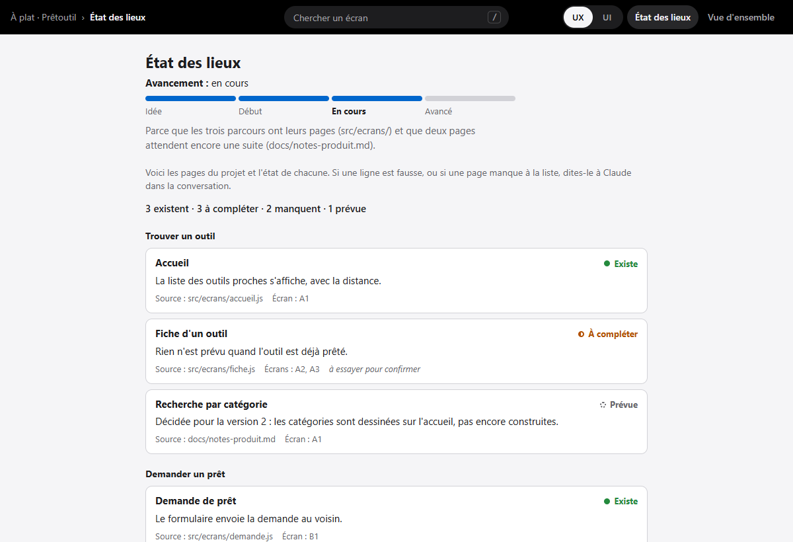
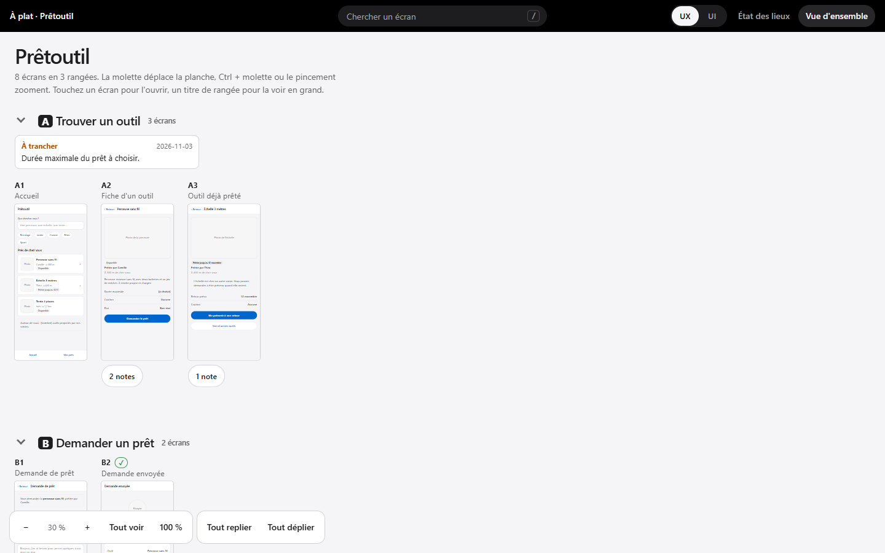
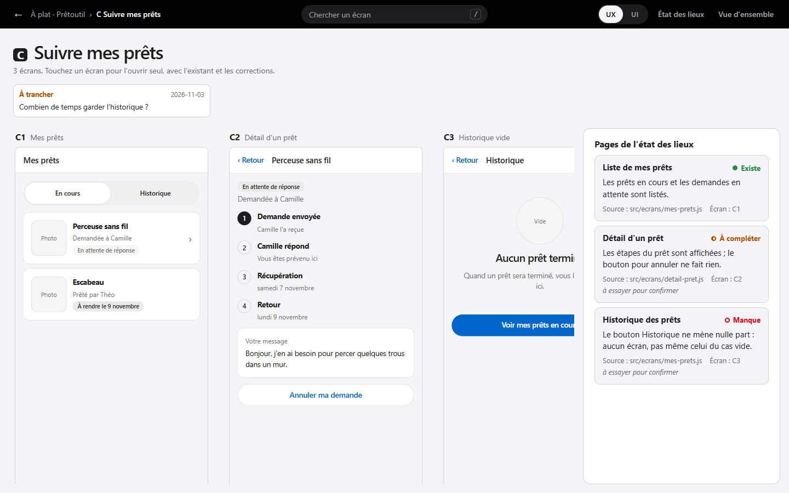
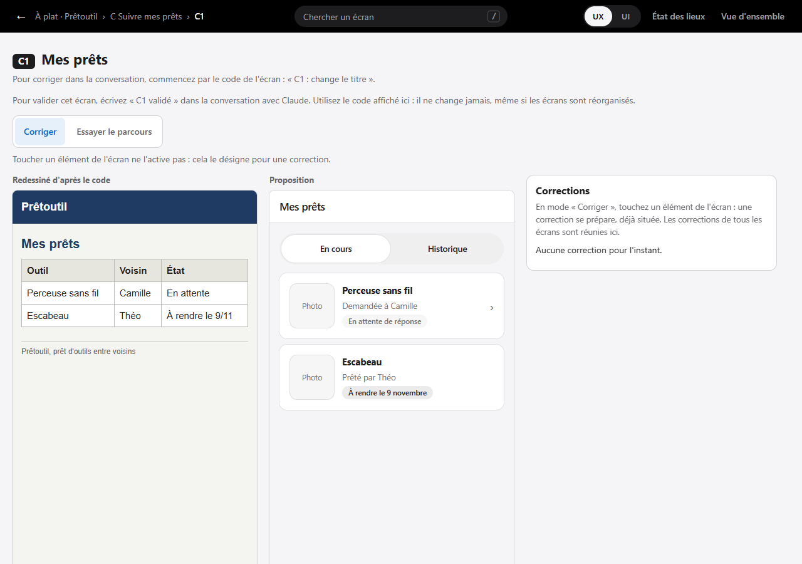
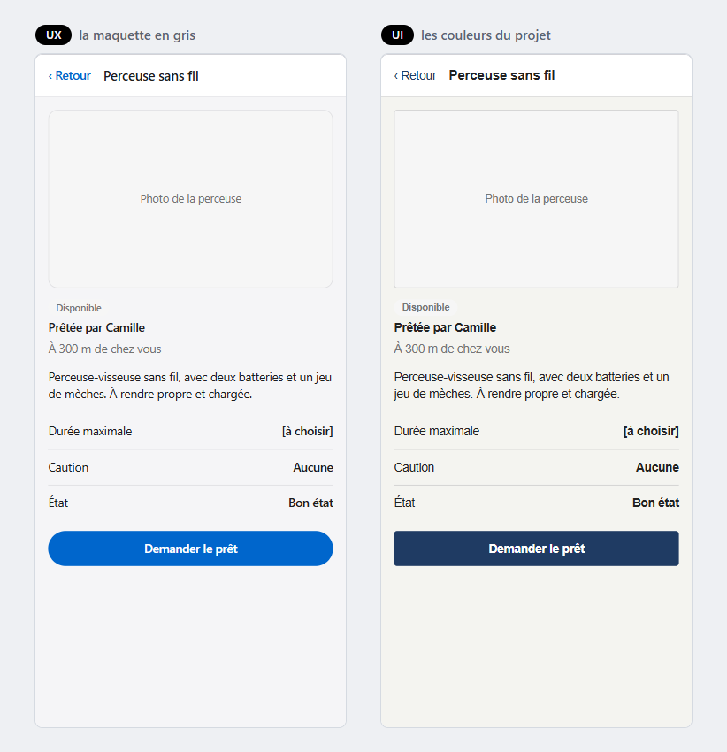
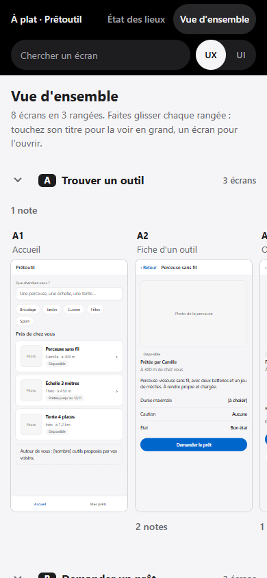

# Utiliser À plat

Cette page suit le parcours avec Claude, étape par étape, puis la page vue par vue. Les captures viennent de la démo du dépôt, Prêtoutil, un projet inventé.

## Le parcours avec Claude

Tout part de `/a-plat`. Claude avance en huit étapes et **s'arrête à chacune** : il finit son message par une seule question et attend ta réponse. Les autres points à trancher sont écrits en phrases : tu y réponds quand tu veux.

### 1. Lire

- **Il y a un projet :** Claude lit le code, les documents, les notes et l'historique Git récent, en lecture seule. Il ne lance rien.
- **Il n'y a qu'une idée :** il pose quatre ou cinq questions courtes, une à la fois : à quoi ça sert, pour qui, ce qu'on y fait d'abord, sur quel appareil, ce qui est déjà décidé.
- **Des maquettes existent déjà :** il les reprend, relit le projet et commence par ce qui a changé depuis. Les codes d'écran, les notes et les écrans validés ne bougent pas.

### 2. L'état des lieux

Claude met la page en place dans `a-plat/`, écrit la liste des pages, puis te la montre aussi dans la conversation : le compte par état, toutes les pages, ce qu'il n'a pas lu, et les points à trancher.

| État | Sens |
|---|---|
| Existe | La page est là, et rien de ce qu'elle annonce ne lui manque |
| À compléter | La page est là, il lui manque quelque chose qu'on peut montrer |
| Manque | Annoncée, attendue ou nécessaire à un parcours, mais absente |
| Prévue | Décidée, pas encore construite |

Tu corriges la liste : « ce n'est pas un manque », « laisse ça de côté », « cette page marche ». Un manque laissé de côté reste dans la liste, avec la date. **Rien n'est dessiné avant ta réponse.**

### 3. Les réglages

Claude propose cinq réglages d'après ton projet, chacun avec sa raison. Tu les changes à tout moment, en le disant (« passe en ordinateur », « on arrête la relecture »).

| Réglage | Choix |
|---|---|
| Format | téléphone, ordinateur, ou les deux |
| Rangement des écrans | par parcours, par personne, par module, par moment, ou existant et nouveau |
| Finition | gris, gris puis couleurs, couleurs du projet, ou fidèle (voir [Les quatre finitions](#les-quatre-finitions)) |
| Rythme | écran par écran, par lots, ou tout d'un coup |
| Relecture par Claude avant de te montrer | oui ou non |

Si des pages existent, c'est le moment de donner des captures : elles montrent l'actuel mieux qu'un redessin. Une capture ne doit pas montrer de données réelles.

### 4. Les premiers écrans

Claude dessine 1 ou 2 écrans seulement, parmi les plus importants, et te demande si la direction et le niveau de détail te vont. Leur barre, leur menu et leurs onglets serviront de modèle à tous les autres.

### 5. Les écrans

Puis le reste, selon le rythme choisi : d'abord les pages qui changent, puis les pages inchangées.

- **Une page qui change :** l'actuel et la proposition, côte à côte. L'actuel est ta capture, sinon il est redessiné d'après le code, et marqué comme tel.
- **Une page à compléter :** seul ce qui change est mis en avant, avec une pastille « Nouveau ».
- **Une page qui ne change pas :** un seul dessin, marqué « Inchangé ».
- **Une page qui manque ou prévue :** dessinée seulement si tu le demandes. Pour une idée, ton accord sur la liste vaut cette demande.

Les textes sont de vrais textes. Les exemples sont inventés, avec un seul jeu pour tout le projet : mêmes prénoms, mêmes objets, mêmes montants. Ce que le projet doit fixer lui-même (un prix de vente, une durée, un texte officiel) reste entre [crochets]. Si tu demandes d'enchaîner, Claude ne s'arrête plus entre les lots, sauf devant une question qui bloque.

Après chaque lot, il relit chaque écran (si la relecture est réglée), lance le contrôle, regarde le rendu s'il en a le moyen, et te dit ce qu'il a vérifié et ce qu'il n'a pas vu.

### 6. Les corrections

Deux façons, au choix :

- **Dans la conversation,** en citant le code de l'écran : « B3 : change le titre », « A1, A2 : retire le bandeau du haut ».
- **Depuis la page,** en mode **Corriger** : touche un élément, un champ s'ouvre déjà situé (« B3 > Bouton Envoyer »), écris ce que tu veux, puis **Ajouter**. **Copier pour Claude** copie toutes tes corrections : colle-les dans la conversation. Une fois appliquées, vide la liste avec **Tout retirer**.

Pour valider : « B3 validé », « toute la rangée B est validée ». Claude ne valide jamais à ta place. Un écran validé qu'on corrige repasse « à relire ».

### 7. Les notes

Les décisions restent à côté des écrans, jamais dessus : des notes courtes, avec un type et une date. Les types : décision, à trancher, à vérifier, à coder, source. Quand une décision change, l'ancienne valeur reste visible, barrée.

### 8. Le passage au code

Quand tu veux, même si tout n'est pas validé : Claude écrit `a-plat/sources/passage-au-code.md`. Il y met les écrans validés et ceux à relire, les décisions, les questions encore ouvertes, ce qu'il faut vérifier, ce qu'il reste à coder avec le fichier à toucher, et les pages qui manquent encore. Ton code n'a toujours pas bougé : coder est la suite, et c'est toi qui la décides.

## La page

Une seule page, `a-plat/index.html`, ouverte d'un double-clic. Elle marche en clair et en sombre, selon le réglage de ton appareil. Les écrans, eux, gardent leurs propres couleurs.

### La barre du haut

La barre noire dit où tu es, avec une flèche pour remonter d'un niveau. Au centre, la recherche trouve un écran par son code ou par un mot de son titre (touche `/`). À droite : le bouton **UX | UI** (s'il y en a un, voir plus bas), **État des lieux** et **Vue d'ensemble**.

Chaque vue a son adresse, que Claude te donne : `#etat`, `#ensemble`, `#rangee/A`, `#ecran/A2`.

### L'état des lieux

En tête, **l'avancement** du projet en quatre étapes (Idée, Début, En cours, Avancé), avec sa raison et ses sources. Puis le compte par état, et chaque page dans son groupe : son état écrit en toutes lettres, la raison, la source, les écrans qui la dessinent, et « à essayer pour confirmer » pour ce qui a été lu sans être vu marcher.

### La vue d'ensemble

Une grande planche : toutes les rangées l'une sous l'autre, chaque écran à sa vraie taille, avec son code (A1, A2, B1…). La molette déplace la planche, Ctrl + molette ou le pincement zoome, et les boutons du bas règlent le zoom (Tout voir, 100 %).

Une note s'affiche sous l'écran qu'elle concerne, ou sous le titre de la rangée si elle vaut pour toute la rangée. Sous un écran étroit, elles se replient en « 2 notes ». Un écran validé porte « Validé », un écran inchangé « Inchangé » ; sous un écran étroit, ils deviennent ✓ et =.

Le chevron devant un titre replie la rangée ; **Tout replier** et **Tout déplier** font toutes les rangées. La page s'en souvient pour ce projet.

### Une rangée

Toucher le titre d'une rangée l'ouvre en grand : ses écrans à une taille de lecture, ses notes, et à droite les pages de l'état des lieux qui citent ces écrans. Toucher un écran l'ouvre seul.

### Un écran

L'écran en grand, avec son code et ses notes. S'il a un actuel, il est à gauche, marqué « Capture de l'existant » ou « Redessiné d'après le code », et la proposition est à côté. Les flèches mènent à l'écran précédent et au suivant.

Deux modes règlent ce que fait un toucher sur l'écran :

- **Corriger** : toucher un élément ne l'active pas, il le désigne pour une correction. Le panneau des corrections réunit celles de tous les écrans.
- **Essayer le parcours** : les liens et les boutons mènent à l'écran suivant, comme dans l'appli.

Si ton navigateur refuse la copie de **Copier pour Claude**, le texte s'affiche dans un champ déjà sélectionné : copie-le toi-même.

### Le bouton UX | UI

Chaque écran est dessiné une seule fois. Le bouton **UX | UI** le montre soit en **UX**, la maquette en gris avec un seul bleu pour ce qui agit, soit en **UI**, aux couleurs, polices et arrondis de ton projet. Il change tous les écrans d'un coup, sans les redessiner. L'actuel garde toujours le vrai style du projet. La page retient ton choix pour ce projet.

### Les quatre finitions

| Finition | Le bouton | Au départ |
|---|---|---|
| Gris | absent : tout reste en UX | UX |
| Gris puis couleurs | présent | UX |
| Couleurs du projet | présent | UI |
| Fidèle | présent | UI, écrite avec le vrai balisage et le vrai style du projet |

Claude la propose d'après les styles qu'il trouve, pas d'après l'avancement : aucun style à toi, gris ; des styles qui commencent, gris puis couleurs ; des variables ou une charte, couleurs du projet. Les couleurs de l'UI sont lues dans tes fichiers de style, jamais inventées.

**La finition fidèle** écrit chaque écran avec les balises et les classes de ton projet, et charge sa vraie feuille de style, ses polices et ses icônes. C'est la plus proche de l'appli, mais une maquette dessinée n'est jamais identique : seule une capture l'est. Elle demande Node, un projet en Tailwind 4 déjà installé ou en feuilles de style simples, et ton accord pour lancer deux scripts qui exécutent des paquets de ton projet (voir [Comment ça marche](comment-ca-marche.md#la-finition-fidèle)). Elle est nettement plus longue à dessiner.

### Sur un téléphone

À la largeur d'un téléphone, la barre passe sur deux lignes et la vue d'ensemble devient une colonne : chaque rangée glisse de côté. Pour voir la page sur un autre appareil, voir [Le voir sur un téléphone](fichiers-du-projet.md#le-voir-sur-un-téléphone).

## Ce que l'outil ne sait pas encore bien faire

À plat est une première version. Voici ce qu'on sait, et ce qu'on ne sait pas.

**Ce qu'il trouve sur un projet qu'il n'a jamais vu.** Sur un projet inventé dont les manques étaient connus d'avance, Claude en a trouvé **13 sur 19**, soit environ 68 %, sans aucune invention selon le comptage de l'auteur de l'essai. Les 3 fausses pistes sont tombées. Les 6 manques ratés sont surtout dans le routeur (la partie qui choisit la page à montrer selon l'adresse) et le chargement des données : accès refusé sans explication, données illisibles, adresse inconnue, retour à la bonne page après la connexion. Deux autres sont des tâches d'un rôle qui n'ont aucun écran. Voir [l'essai sur Jardins](essais/2026-11-06-jardins.md).

Ce chiffre est fragile : un seul passage, un seul projet, le modèle Sonnet, compté par une seule personne. La méthode a été retouchée après cette mesure, et ces retouches ne sont pas mesurées. Le 17 sur 17 du premier projet d'essai ne compte pas : c'est le projet qui a servi à la mettre au point ([l'essai sur Prêtoutil](essais/2026-11-06-pretoutil.md)).

**Ce que Claude a mal fait pendant les essais.** Il a affirmé un rendu qu'il n'avait pas vu (un tableau qui déborde), repris des textes du projet alors qu'il disait n'avoir repris aucune donnée, et retiré de la liste un manque qu'on lui avait seulement dit de laisser de côté. Sur un gros projet, les menus ont varié d'un lot à l'autre. La méthode a reçu une règle contre chacun de ces défauts, mais elles n'ont pas été remesurées. **Relis ce qu'il dit.**

**Ce qui a été essayé pour la page.** Des tests automatiques sous Edge et Chrome, en ouvrant la page par son adresse de fichier (comme d'un double-clic) et par une adresse web locale, à 390 px de large, en clair et en sombre, avec un toucher simulé.

**Ce qui n'a pas été essayé :** Firefox et Safari ; macOS et Linux ; Node 18 ; un vrai téléphone, au doigt ; le vrai presse-papiers ; l'installation depuis GitHub de bout en bout, la mise à jour et le retrait ; un essai par une personne qui n'a pas construit l'outil.

**Pas dans cette version :** la modification directe dans la page, l'écriture directe des corrections, la publication en ligne, d'autres assistants que Claude.
